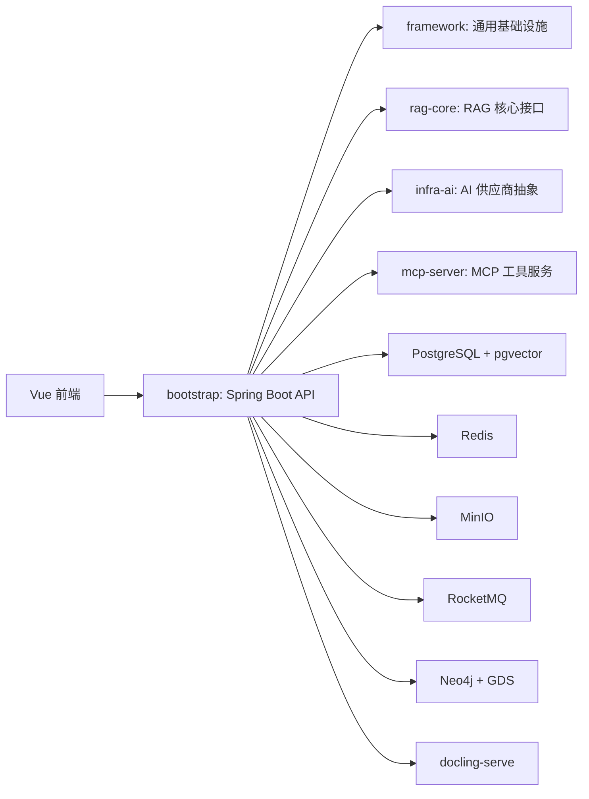

# 技术选型决策（v3）

> 状态：本文档是 RAG2Agent 技术选型阶段的最终决策记录。v1 定稿于 2026-08-06；v2 按企业级六维要求升级：智能体可观测性与流程刚性、存储层高并发/集群/读写分离/向量库/图数据库、检索 Query Routing 与混合检索、模型层大小混用与网关、工具链协议与敏感操作机制、工程底座可观测/缓存/异步。v3 于 2026-10-22 增加多模态文档智能、跨页表格、持久 Agent Runtime、推理模式、受控多 Agent 和 GraphRAG 全局检索决策。
> 后续实现以此为准；如选型变更，必须同步更新本文档并注明变更原因。
> 版本信息变化快，落地实现时以各组件当时的官方文档和最新稳定版为准。
> 功能范围、阶段依赖与验收标准见 [enterprise-agent-upgrade-plan.md](enterprise-agent-upgrade-plan.md)。

## 1. 选型原则

- 企业级 = 可维护、可观测、可测试、可扩展、安全、成本可控，而不是"能跑就行"。
- 六维硬性要求必须落到具体组件与机制：智能体流程刚性 + 可观测；存储高并发/集群/读写分离/向量/图；检索路由 + 混合 + 重排；模型大小混用 + 网关；工具协议 + 敏感操作机制；工程可观测 + 缓存 + 异步。
- AI 供应商与向量存储通过接口抽象可替换，核心链路不绑定任何单一框架。
- 模型名、供应商、密钥、路由策略全部配置化，禁止硬编码（DeepSeek 2026-07 已停用旧模型名，这是真实教训）。
- 落地分期：第一版实现可演示闭环，但代码按演进设计写（不写单机专属 hack）；集群、HA、分片作为演进路径明确记录，不欠账、不空谈。
- v3 扩展原则：文档解析可使用专用 sidecar，业务编排、权限、审计和 Agent 状态继续由 Java 主链路控制；多 Agent 和图检索只在有评测收益时启用。

## 2. 全景决策表

| 层次 | 决策 | 备选 | 决策理由 |
|---|---|---|---|
| 前端 | Vue 3 + Vite + TypeScript + Pinia + Vue Router + Element Plus | Naive UI | 国内企业主流、生态全；TS 支撑聊天/流式渲染复杂状态 |
| 后端 | Java 21 + Spring Boot 3.5 + WebMVC + 虚拟线程 + Maven 多模块 | WebFlux | 虚拟线程让阻塞式 AI 调用简单可靠，调试排障成本低 |
| 智能体框架 | 自建持久化事件溯源 Runtime：Session/Event/Task/Checkpoint/ToolCall/Artifact 全部落库，支持预算、恢复、转向、审批和受控多 Agent | Temporal / LangGraph / OpenAI Agents SDK | 与现有 Java 状态机、权限、审计、OTel 一致；复杂编排保留单拓扑扩展点 |
| AI 抽象 + 网关 | `infra-ai` 接口 + 自建 model-gateway；增加 `CHAT/VISION/EMBEDDING/RERANK` 能力、推理档位、模型能力协商、路由、限流、熔断、重试和成本计量 | Spring AI / LangChain4j | 抽象薄、治理收敛点明确，模型名和供应商配置化 |
| 模型 | Chat 大小混用：flash 做路由/分类/抽取，pro 做规划/合成/评审；Vision 使用可配置 Qwen3-VL；Embedding BGE-M3；Rerank bge-reranker-v2-m3 | 本地 vLLM / 其他 OpenAI-compatible Vision | 中文与文档视觉能力覆盖完整，能力通过网关替换 |
| 文档智能 | `docling-serve` sidecar：多格式、版面、阅读顺序、TableFormer、RapidOCR、DoclingDocument JSON；文本型 PDF 保留 PDFBox 快速路径 | PaddleOCR PP-StructureV3 / Tika / 纯 PDFBox | 一套解析覆盖 PDF、扫描件、图片和 Office，保留页码、坐标与表格结构 |
| 业务/元数据存储 | PostgreSQL 17 主从（流复制）+ 读写分离（应用层路由，演进 PgBouncer + HAProxy + Patroni） | 单库单机 | 元数据与事务一致性用 PG 最稳，读写分离按演进设计 |
| 向量存储 | pgvector 0.8（第一版主实现，与元数据同库、事务一致）；`VectorStoreClient` 抽象预留 Qdrant / Milvus 集群 | Qdrant 直接上 / Milvus 直接上 | 第一版简单可靠，演进有明确替代路径（判据见 3.2） |
| 图数据库 | Neo4j + GDS：证据边、实体消解、多跳路径、Leiden 社区摘要和受限图工具 | 纯文档向量 / 外部 GraphRAG 服务 | 关系型问题与全局归纳共用同一图数据面，权限和故障降级可控 |
| 缓存 | 两级：本地 Caffeine（L1）+ Redis 7（L2，Cluster 模式设计，Redisson） | 仅 Redis | 热点与成本敏感场景必须多级缓存 |
| 对象存储 | MinIO（S3 兼容，presigned URL；演进多节点纠删码） | 本地磁盘 | 文档原文留存 + 引用溯源 |
| 消息队列 | RocketMQ 5（入库/Embedding/审计/事件异步；事务消息、延迟、死信） | Kafka | Java 原生、国内主流、事务/延迟/死信齐全 |
| RAG 检索 | Query Routing → 文本/表格/图片/图多路召回 → RRF → Rerank → 上下文扩展 → 权限与证据过滤 | 纯向量检索 | 专有名词、表格、图表和关系型问题必须多路解决 |
| 工具链 | MCP 标准协议（官方 Java SDK 2.0 / Streamable HTTP）+ 内部工具注册表；敏感度分级 + 审批摘要绑定 + 审计 + 幂等 | 自研私有协议 | 工具协议标准化、协议生命周期完整、审批绑定可验证 |
| 流式输出 | SSE（text/event-stream），结构化事件（引用/工具状态/文本增量） | WebSocket | 问答场景 SSE 足够 |
| 工程可观测 | OpenTelemetry + Micrometer/Prometheus + Grafana + JSON 日志（Loki 演进） | 仅日志 | 全链路 trace + 成本指标是企业级标配 |
| 安全 | Sa-Token 鉴权；tenant/kb/document 统一 ACL；强制租户过滤；presigned URL；提示注入防护；工具沙箱；Redis 令牌桶限流；全量审计 | Spring Security | 国内企业标配、权限边界可验证 |
| 评测 | 自建评测框架：检索 + 解析/表格 + GraphRAG + 推理档位 + Agent 轨迹 + 配置矩阵 + CI 冒烟 | RAGAS（Python） | 一套任务恢复与报告体系覆盖 RAG 和 Agent，Java 主线自建闭环 |
| 部署 | Docker Compose（dev/演示）+ 多阶段镜像；K8s + Helm 演进 | 直接上 K8s | 现阶段避免运维负担，镜像按可部署标准做 |

## 3. 企业级能力维度详解

### 3.1 智能体框架：可观测性与流程刚性

v3 决策：继续自建 Agent Runtime，从“单次状态机”升级为“事件溯源 + 任务图 + 检查点”的持久执行面，不把主业务控制权交给外部 Agent 框架。

- 核心模型：AgentSession → AgentEvent → AgentTask → AgentCheckpoint → ToolCall → Artifact；现有 AgentRun/Step 保留兼容查询。
- 状态机显式定义：INIT → ROUTING → EXECUTING → WAITING_APPROVAL → FINALIZING → COMPLETED / FAILED / CANCELLED。
- 流程刚性落地：
  - 事件日志作为权威状态，Redis Stream 只负责 SSE 投递；
  - 检查点保存事件游标、任务图、摘要、预算、审批和产物引用，应用重启可恢复；
  - 计划、执行、验证和重新规划是显式任务状态；
  - 最大迭代、工具调用、深度、时间、Token 和费用统一预算，防失控循环；
  - 每步幂等（工具幂等键），失败重试有上限，超限进 FAILED + 死信；
  - 人工审批是显式状态，审批记录绑定规范化操作摘要和哈希，执行前再次校验；
  - 支持暂停、恢复、取消、追加指令和人工接管。
- 可观测性落地：
  - 每步一个 OpenTelemetry Span，覆盖计划、检索、表格分页、图路径、模型、推理档位、工具、审批和恢复；
  - 执行轨迹、路由决策、证据、预算和版本组合进入事件日志，作为审计与评测数据源；
  - 指标：步骤耗时、工具成功率、迭代轮数、审批等待、恢复成功率、预算耗尽和降级率。
- 推理模式：模型能力注册表声明可用的推理档位；请求使用统一逻辑档位，由 Provider Adapter 映射供应商参数；推理摘要、Token、耗时和结束原因进入 trace。
- 多 Agent：只落地 Coordinator-Worker-Reviewer 单拓扑；主 Agent 负责计划与汇总，Worker 使用独立上下文和工具白名单，Reviewer 独立验证证据与输出契约。
- 备选与演进：Temporal（持久化工作流：重试/定时/信号），编排复杂度显著上升后再评估；Camunda 偏向人工流程 BPM，本项目不引入。
- 工程要点：为什么"刚性"是 Agent 进生产的前提；事件溯源 vs 单一状态字段；审批绑定；推理档位与预算；单 Agent 与多 Agent 的收益判据。

### 3.2 存储层：高并发 / 集群 / 读写分离 / 向量库 / 图数据库

分层决策：

1. 业务元数据（知识库/文档/chunk/任务/评测）：PostgreSQL 17
   - 高可用：主从流复制 + Patroni 自动故障转移（演进）；
   - 读写分离：应用层 `AbstractRoutingDataSource`（写主读从，`@Transactional(readOnly=true)` 路由读），连接池 PgBouncer、入口 HAProxy（演进）；
   - 集群扩展：数据量/并发到瓶颈后评估 Citus 分片（按租户/知识库维度）。
2. 向量检索：pgvector 0.8（第一版主实现）
   - HNSW 索引 + halfvec + binary_quantize + 迭代索引扫描；
   - 演进候选：Qdrant 集群（Raft 元数据一致性 + 分片复制，3 节点起步）与 Milvus 集群（2.6.x / 3.0.x，亿级向量、GPU 索引、原生混合检索）；
   - `VectorStoreClient` 双实现 + 配置路由，接口不变，迁移只改实现与配置。
   - 切换判据：千万级以下、强过滤、轻运维 → Qdrant；亿级向量 / GPU 索引（DiskANN、CAGRA）/ 目标企业技术栈明确使用 Milvus → Milvus；起步阶段要事务一致 → 维持 pgvector。
3. 图数据库：Neo4j
   - 用途：GraphRAG——实体/关系抽取建图、证据边、实体消解、多跳查询、关系召回和全局社区归纳；同时作为 Agent 的受限图工具；
   - 局部检索：实体链接 → 一跳/两跳路径 → 邻域扩展 → 与向量/关键词/表格结果融合；
   - 全局检索：Neo4j GDS Leiden 形成社区，LLM 生成带证据的社区摘要；
   - 安全边界：图查询只使用项目内参数化模板，节点、关系、证据和查询参数均受 tenant/kb 权限约束；
   - 容错：Neo4j 超时、不可用或熔断时回退文本检索，响应标记图检索未参与；
   - 落地：第一版 Docker 单实例跑通 GraphRAG 链路，集群/因果一致性作为演进。
4. 缓存层：Redis 7（单实例开发，代码按 Cluster 模式设计，Redisson 客户端），演进 3 主 3 从集群。
5. 对象存储：MinIO 单机起步，演进多节点分布式（纠删码、版本控制、生命周期策略）。
6. 消息队列：RocketMQ 5（见 3.6），Broker 单机开发，Producer/Consumer 按集群语义编写。

读写分离与集群是"设计预留 + 演进路径"：第一版代码按多数据源/集群客户端 API 编写，保证演进只改配置不动架构。

工程要点：为什么元数据用 PG 而非全上 NoSQL；读写分离放应用层还是代理层；向量库演进判据（数据量/并发/召回率 vs 运维成本）；图检索解决什么（关系型、多跳问题，纯向量做不到）。

### 3.3 检索策略：Query Routing / 多路召回 / 融合 / 重排

- Query Routing（前置路由）：
  - 规则路由（关键词/正则/黑名单）先拦截确定场景；
  - 小模型分类器（deepseek-v4-flash）对模糊问题做意图/类型分类，输出 routing plan；
  - 路由目标：关键词检索（BM25/tsvector）、语义检索（向量）、表格行检索、图片/图表语义检索、图检索（Neo4j）、Agent 工具、直接生成（无检索）。
- 多路召回：BM25（tsvector/pg_trgm）+ 向量（pgvector HNSW）+ 表格行语义 + 图片/图表描述 + 图（Neo4j，可选）并行取 TopK。
- 融合：RRF（Reciprocal Rank Fusion），k 值经评测确定。
- 重排：bge-reranker-v2-m3（cross-encoder）精排 → 权限过滤 → 表格/页码/邻域上下文扩展 → 证据组装。
- 表格完整性：表格行生成带完整表头的语义文本；命中后扩展表标题、表头、同行、相邻行、单位、脚注和续表。
- 多模态完整性：OCR、视觉描述、表格行和原文文本分别标注来源类型；图片检索使用统一文本检索视图，原始资产保留在 MinIO。
- 全链路可观测：每次查询记录路由决策、各路召回分数、融合结果、重排结果、表格分页、图路径和耗时。
- 工程要点：为什么需要路由而不是一套检索打天下；RRF 为什么比加权和稳；路由分类为什么用小模型（成本/延迟）。

### 3.4 模型层：大小混用 / LLM 网关 / Embedding

- 大小模型混用（级联策略）：
  - 小模型（deepseek-v4-flash 等便宜模型）：Query 重写、意图/路由分类、实体抽取（建图）、摘要、答案初筛；
  - 大模型（deepseek-v4-pro）：复杂问题规划、长上下文合成、答案评审/校验；
  - 升级机制：置信度阈值 / 任务类型 / 失败降级，全部配置驱动；成本-延迟-质量指标驱动调参。
- LLM 网关（model-gateway，自建模块，基于 infra-ai）：
  - 职责：Provider 路由与负载均衡、限流（用户级/全局）、熔断降级、重试、Key 管理、Token/成本计量、Prompt/响应缓存、审计；
  - 协议：OpenAI 兼容（一套协议覆盖 DeepSeek/Qwen/SiliconFlow/OpenAI）；
  - 演进：可对接 One-API/New API 类网关做计费与 Key 管理（若自建计量不够），核心路由逻辑保留在自建网关；
  - 工程要点：网关是 AI 应用的企业级标配（成本与治理的收敛点）；自建 vs 开源网关的取舍。
- Embedding：BGE-M3（稠密+稀疏一体）；Query 侧可先小模型改写再 embedding；结果按文本 hash + 模型维度进 Redis 缓存；Rerank 用 bge-reranker-v2-m3。
- 多模态模型：Vision 能力使用可配置的 Qwen3-VL 系列，生成图像/图表描述、OCR 辅助、表格续页校验和结构化输出；模型 ID、推理档位、供应商和预算全部配置化。
- 能力注册：每个模型声明 CHAT/VISION/EMBEDDING/RERANK 能力、推理档位、上下文、输出上限、结构化输出、图片输入和成本。
- 推理路由：简单分类和抽取使用低档位；复杂规划、跨页表格、图路径解释和评审使用更高档位；超时、限流或无预算时进入明确降级。
- 演进：私有化推理 vLLM（OpenAI 兼容 API），第一版不引入本地 GPU 依赖。

### 3.5 工具链：工具协议 / 敏感操作机制

- 工具协议：采用 MCP Java SDK 2.0，优先使用 Streamable HTTP；内部工具与远程工具统一进工具注册表。
  - 统一 ToolDescriptor：名称/描述/参数 JSON Schema/敏感度/授权角色/超时/重试/幂等键/成本等级；
  - SDK 能力：工具发现、调用、资源、提示词、能力协商、进度、OAuth 挂钩和 Schema 校验；
  - 接入通道：内部 Java 工具 + 本地/远程 MCP Server；项目内 JSON-RPC HTTP 子集保留为兼容路径。
- 敏感操作机制：
  - 敏感度分级：只读（查询/检索）→ 普通写（知识库内操作）→ 高风险（跨系统、外部副作用、删除、支付类）；
  - 高风险操作必须 human-in-the-loop 审批，审批动作全审计；
  - 审批记录绑定工具名、完整规范化参数、目标、主体、会话和有效期；执行前重新计算摘要并比对；
  - 工具入参按 JSON Schema 严格校验；出参过脱敏/过滤（敏感数据、PII）；
  - 工具幂等设计（幂等键落库），防止重试副作用；
  - 按角色/租户授权工具可见性；工具调用计入限流与成本；
  - 有副作用的本地工具在隔离环境中执行，限制网络、文件、进程、CPU、内存、时间和输出大小。
- 工程要点：MCP 解决了什么（工具协议标准化）；敏感度分级与审批是 Agent 落地的安全底线。

### 3.6 工程底座：可观测性 / 缓存 / 异步

- 可观测性：
  - Trace：OpenTelemetry Java agent + OTLP，HTTP → 路由 → 检索 → 重排 → 模型 → 工具 → 异步任务全链路；
  - Metrics：Micrometer（QPS、P99 延迟、Token 成本、错误率、缓存命中率、队列积压/消费延迟）→ Prometheus + Grafana；
  - Logs：JSON 结构化 + traceId/spanId + 业务维度（userId/知识库/模型）；集中收集 Loki（演进）；
  - 告警：延迟/成本/错误率阈值告警（演进）。
- 缓存层（多级）：
  - L1 本地 Caffeine：热点检索结果/配置/路由表，短 TTL；
  - L2 Redis：embedding 向量、检索结果（同 query 短 TTL）、会话记忆、限流计数、分布式锁；
  - 一致性：版本号/失效策略；写路径先失效再回源；缓存命中率纳入指标。
- 异步处理：
  - RocketMQ 5 承载：文档解析/切块/Embedding 批量任务、索引构建、审计日志异步落库、Agent 事件；
  - 可靠性：任务状态机 + 消息重试 + 死信队列 + 消费幂等（消息去重键）；延迟消息用于重试退避；
  - 队列指标：积压数、消费延迟、死信数纳入监控。
- 工程要点：AI 场景缓存命中率直接等于成本；异步任务的可观测闭环（状态机 + 消息 + 指标三件套）。

## 4. 其他层决策

### 4.1 前端

- Vue 3 + Vite（已定），补 TypeScript；Pinia + Vue Router + Element Plus。
- 关键页面：对话页（SSE 流式渲染 + 推理状态 + 引用卡片 + 工具调用 + 审批弹窗）、知识库管理（上传/解析/索引状态）、表格与资产预览、Agent 轨迹和评测实验页。
- 多模态引用：展示页码、bbox、图片裁剪和元素类型；表格引用展示表标题、表头和续表关系。
- 表格分页：固定表 ID、行范围和 cursor，每页重复表头，支持续页标识和来源页码。
- 流式：聊天是 POST，用 `fetch` + `ReadableStream` 解析 SSE（`EventSource` 只支持 GET）。
- 工程要点：流式增量渲染状态管理；推理内容与最终答案分离；引用、表格分页和审批状态的前端呈现。

### 4.2 后端与并发

- WebMVC + 虚拟线程（`spring.threads.virtual.enabled=true`）；OkHttp 连接池 + 独立 connect/read/write 超时；Resilience4j 在 client 外层做重试/熔断/降级。
- 多数据源：`AbstractRoutingDataSource` 读写分离 + 事务边界规范（写操作走主库、`@Transactional(readOnly=true)` 走从库）。
- 工程要点：虚拟线程 vs WebFlux；读写分离的事务边界坑（读从库读到旧数据）。

### 4.3 文档入库 Pipeline

- 解析：`docling-serve` 负责 PDF、扫描件、PNG/TIFF/JPEG、DOCX、PPTX、XLSX、HTML 和邮件；输出 DoclingDocument JSON、页面图和表格结构。
- 轻量路径：文本型 PDF 可由 PDFBox 直接解析；Docling 不可用或超时时按文件类型降级，失败原因进入任务状态。
- OCR：Docling + RapidOCR，保留文本、坐标、置信度和语言；低置信度结果进入质量报告。
- 视觉语义：Qwen3-VL 生成图片/图表描述、图像文字、表格核验和结构化字段；模型结果绑定资产和 bbox。
- 统一元素：解析结果映射为 `document_element`、`document_table`、`document_table_row` 和 `document_asset`。
- 切块：标题感知 + 父子块 + overlap；表格按逻辑表切分，禁止表头与数据行分离。
- Embedding：文本、OCR、视觉描述和表格行统一生成 BGE-M3 向量；批量、幂等（文档版本号 + 内容 hash）、失败重试。
- 任务状态机：PENDING → PARSING → OCR → TABLE_EXTRACTING → EMBEDDING → GRAPH_EXTRACTING → INDEXED / FAILED，经 RocketMQ 触发，延迟消息重试，死信记录。
- 版本化：文档版本切换和旧元素/资产/向量清理保持事务一致；模型或解析器升级支持批量重建。
- 工程要点：解析质量决定 RAG 上限；跨页表格必须保留表头；切块策略必须用评测数据决策。

### 4.4 生成与引用溯源

- 检索结果强制带引用（chunk/element/table row/asset → document + version + page + bbox + MinIO 原文），无引用不答。
- 表格引用包含表标题、表头、行 ID、页码和续表关系；图片引用返回裁剪区域。
- SSE 分开输出状态、计划、工具进度、引用和最终答案。
- 图检索引用包含实体、关系路径、证据元素和来源文档。

### 4.5 安全

- Sa-Token 鉴权；tenant/org/kb/document 统一 ACL；检索 SQL、图查询和记忆检索强制租户过滤。
- MinIO presigned URL 受资源权限和短期有效期控制；上传执行大小、MIME、文件头、恶意文件和压缩炸弹检查。
- 提示注入防护：系统提示隔离、工具白名单、输入信号、输出过滤和高风险操作审批。
- MCP 与工具：Schema 校验、allowlist、最小权限、超时、沙箱、SSRF 防护和外发数据审计。
- 审批：操作摘要哈希在审批和执行两端一致；有效期、主体、会话和参数不可替换。
- 令牌桶限流；全量审计；低置信度 OCR/VLM 和灰区表格合并进入人工复核。

### 4.6 部署

- 开发/演示：Docker Compose；应用镜像：多阶段 Dockerfile（Maven 构建 → JRE 21 运行时），非 root 运行；配置环境变量驱动，密钥不进仓库；K8s + Helm 演进。
- 文档智能：`docling-serve` 作为独立容器运行在内部网络，固定镜像摘要，限制 CPU、内存、并发和请求超时，默认不对外暴露。
- 图能力：Neo4j 挂载 GDS 插件；图查询通过 Java 服务执行参数化模板，Neo4j 端口不直接向浏览器暴露。
- 配置与密钥分离的完整说明与演进路径见第 11 节。

## 5. 明确不选

- Spring AI / LangChain4j 作为核心：版本分裂（Spring AI 2.0 基于 Boot 4，Boot 3.5 对应 1.1.x）、抽象厚、定制受限；仅作参考与备选 Provider。
- Temporal / Camunda：第一版自建状态机足够；编排复杂度显著上升后再评估 Temporal。
- Elasticsearch / OpenSearch：tsvector + pg_trgm 起步；中文分词或规模成为瓶颈后再评估。
- WebFlux：虚拟线程已解决阻塞 IO 并发。
- gRPC：内部 REST + MCP 足够。
- Kafka：第一版用 RocketMQ（Java 原生、事务/延迟/死信齐全、国内主流）；若后续需要更强流处理生态再评估。
- 开放式自主多 Agent：不可控，安全与成本风险高；只采用有边界、有预算、可终止的 Coordinator-Worker-Reviewer 拓扑。
- 自研私有工具协议：统一走 MCP。
- 通用 GraphRAG 平台或任意 Cypher：使用有限本体、参数化模板、证据边和权限过滤。

## 6. 生态现状快照（2026-10，落地时复核）

- Spring Boot 3.5.7（pom 已定）；Spring AI 2.0 已 GA 但基于 Boot 4 / Spring Framework 7，Boot 3.5 对应 Spring AI 1.1.x 稳定线。
- pgvector 0.8.x：halfvec、sparsevec、binary_quantize、迭代索引扫描、HNSW 构建提速。
- MCP Java SDK 2.0.0 GA：Streamable HTTP 优先，覆盖 2025-11-25 MCP 规范、工具/资源/提示词、Schema 校验和能力协商。
- DeepSeek：`deepseek-chat` / `deepseek-reasoner` 已于 2026-07-24 停用，新模型名以 `deepseek-v4-flash` / `deepseek-v4-pro` 为代表。
- SiliconFlow：`BAAI/bge-m3`（embedding）、`BAAI/bge-reranker-v2-m3`（rerank）API 可用。
- Docling 2.133.x：多格式文档解析、版面、表格、OCR、图表、页面图、DoclingDocument JSON 和 docling-serve。
- Qwen3-VL：支持图片、视频、OCR、结构化输出、2D 定位和思考模式；模型 ID 与供应商配置化。
- Qdrant 分布式：Raft 元数据一致性 + 数据分片复制，最小可用集群 3 节点。
- Milvus 2.6.x / 3.0.x：原生混合检索（Sparse-BM25）、GPU 索引（HNSW / DiskANN / CAGRA）、亿级向量；Java SDK 3.x。
- RocketMQ 5.x：事务消息、延迟/定时消息、死信队列，Java 5.x SDK。
- Neo4j：官方 GraphRAG 支持（2026 版本），Cypher 多跳检索；GDS 提供 Leiden、路径、相似度和图投影。
- PostgreSQL HA 主流组合：Patroni（故障转移）+ PgBouncer（连接池）+ HAProxy（入口/负载均衡）。
- Redisson：Redis Cluster 客户端标准；Caffeine：JVM 本地缓存标准。

## 7. 落地分期

### 第一期（可演示闭环，代码按演进设计写）

- 单体部署：PostgreSQL 单主（读写分离代码预留）+ pgvector + Redis + MinIO + RocketMQ 单 Broker + Neo4j 单实例。
- Agent 持久化状态机 + 人工审批 + 轨迹落库。
- Query Routing（规则 + 小模型分类）+ 混合检索 + RRF + Rerank + GraphRAG 图召回。
- 模型级联（flash/pro）+ 自建网关基础版 + BGE-M3 / bge-reranker API。
- 两级缓存（Caffeine + Redis）+ OpenTelemetry + Prometheus + JSON 日志 + RocketMQ 异步入库。
- 评测集 + 配置矩阵实验 + CI 冒烟评测。

### 演进（设计预留，不在第一版引入）

- Patroni + PgBouncer + HAProxy（读写分离与 HA）；Citus 分片。
- Redis Cluster 3 主 3 从；MinIO 多节点分布式（纠删码）。
- Qdrant 集群（3 节点）或 Milvus 集群（按 3.2 判据选择）；Neo4j 集群。
- Temporal（复杂编排需求出现时）；One-API（外部计费/Key 管理）；vLLM（私有化推理）。
- K8s + Helm。

### 分阶段落地顺序（Phase 1-6）

> 与"第一期 / 演进"互为补充：Phase 按能力域切分，体现从骨架到生产级的演进节奏；第一期按"可演示闭环"划定首期边界。以本节为准，避免两处口径漂移。

- Phase 1 基础工程框架：Maven 多模块、Spring Boot 启动、Docker Compose 中间件、AI 与 RAG 核心接口、最小 Vue 前端、健康检查/版本信息/Provider 占位。
- Phase 2 企业业务底座：用户/组织/角色权限、知识库与文档元数据、审计日志、MinIO 上传链路。
- Phase 3 RAG 文档入库：解析 Pipeline、清洗切块、Embedding + pgvector 写入、任务状态与失败重试。
- Phase 4 问答与引用溯源：混合检索、Rerank、Prompt 构造、SSE 流式回答、引用来源与权限过滤。
- Phase 5 受控 Agent：意图识别、RAG 与工具调用路由、MCP 工具接入、运行轨迹与人工确认。
- Phase 6 生产级增强：模型路由/熔断/降级、限流与成本统计、OpenTelemetry Trace、RAG 评测集与反馈闭环。

### V3 企业级多模态 Agent 升级阶段（Phase 0-7）

详细交付物、依赖和退出条件见 [enterprise-agent-upgrade-plan.md](enterprise-agent-upgrade-plan.md)。

- Phase 0 基线、Gold Set、数据契约和迁移方案。
- Phase 1 Docling 文档智能 sidecar、统一元素、资产和 PDFBox 降级。
- Phase 2 逻辑表格、跨页续表、表头传播、稳定分页和表格计算工具。
- Phase 3 OCR/Vision/表格行/文本统一检索与区域级证据。
- Phase 4 持久 Agent Runtime、检查点、任务图、推理模式和 MCP 2.0。
- Phase 5 知识图谱、GraphRAG 局部路径、GDS 全局社区和权限降级。
- Phase 6 Coordinator-Worker-Reviewer、长期记忆和 Skill。
- Phase 7 租户 ACL、模型网关、版本中心、评测门禁和发布控制。

## 8. 技术亮点与决策主线

1. 为什么 Java 不用 Python：就业主线 + AI 能力基础设施化。
2. 智能体流程刚性：状态机 + 幂等 + 审批门 + 轨迹审计，而不是自由循环。
3. 自建 AI 抽象与 LLM 网关：为什么不用 Spring AI；网关收敛治理与成本。
4. Query Routing + 混合检索 + RRF + 重排：每一条都是可解释的工程决策。
5. 存储分层与演进：读写分离、向量库、图库各解决什么问题，演进判据是什么。
6. 大小模型混用与成本指标：小模型分流、升级机制、成本-延迟-质量三角。
7. 工具链：MCP 协议 + 敏感操作审批。
8. 工程底座：可观测、多级缓存、异步任务闭环。
9. RAG 评测：没有评测不谈优化。

## 9. 模块边界与架构取舍

### 9.1 模块总览

### 9.2 模块边界

- `framework` 只放通用工程能力：统一响应、异常处理、Redis、鉴权、ORM、限流和 Trace 预留。
- `infra-ai` 屏蔽 AI 供应商差异，并承载外部模型/文档智能客户端：Chat、Vision、Embedding、Rerank、VectorStore、Docling HTTP 和结构化输出。
- `rag-core` 定义 RAG 链路抽象：文档元素、表格、证据、解析、切块、检索、重排、图检索接口和 Prompt 构造。
- `mcp-server` 负责 MCP Java SDK 2.0、Streamable HTTP、工具/资源/提示词生命周期和鉴权边界。
- `bootstrap` 负责应用启动、配置装配和对外 API，是唯一对外入口。

### 9.3 设计取舍（与第 5 节互补）

- Python 只用于 `docling-serve` 文档智能 sidecar；业务编排、权限、审计、Agent Runtime 和 API 仍由 Java 主链路负责。
- 文档 sidecar 通过 HTTP 和 JSON 返回结果，不直连业务数据库；MinIO、PostgreSQL 和图写入由 Java 服务控制。
- 其余取舍（不引入 Spring AI / LangChain4j、pgvector 预留 Qdrant、只留受控 Agent 扩展边界）见第 5 节"明确不选"及 3.1 / 3.2。

### 9.4 生产级能力预留（对应第 3 节各维度）

- 多模型 Provider 路由、推理档位、熔断和降级；用户级、租户级和全局模型调用限流；检索、重排、模型、工具、表格和图检索 Trace；tenant/org/kb/document 权限过滤；文档解析、OCR、Embedding、建图和评测异步任务；用户反馈与评测数据闭环。落地时序见第 7 节 Phase 0-7。

## 10. V3 企业级升级决策记录

本节记录 2026-10-22 的选型过程。每项决策均以计划文档中的数据契约和 Gold Set 验收为准。

以下 D-01 至 D-13 为已采纳的实施方案，当前仍处于方案阶段，尚未进入代码实现。

| 编号 | 决策 | 比较过的方案 | 结论与原因 | 验证方式 |
|---|---|---|---|---|
| D-01 | 文档解析主路径采用 Docling Serve | PDFBox + Tabula、Tika、PaddleOCR PP-StructureV3、纯 VLM | 一套服务覆盖多格式、版面、表格、OCR 和区域证据；Java 侧保留业务控制 | 多格式样例、元素映射率、表格结构和端到端入库 |
| D-02 | PDFBox 保留为文本 PDF 快速路径 | 全量走 Docling | 轻文件降低延迟和资源占用；sidecar 故障时可明确降级 | 文本 PDF A/B、sidecar 不可用演练 |
| D-03 | Vision 能力采用可配置 Qwen3-VL | 本地 GraniteDocling、其他 OpenAI-compatible Vision | 中文 OCR、图表理解和结构化输出覆盖完整；通过 `VISION` 能力替换供应商 | 图表问答、图片描述、低置信度复核和多模态引用 |
| D-04 | 图片检索先统一到文本语义视图 | 独立视觉向量索引 | 复用 BGE-M3 和 pgvector，避免第二套向量空间；原始图片仍保留并用于精确展示 | 文本→图片、图片→证据、图表问答 A/B |
| D-05 | 表格由 Java 建立逻辑表格和跨页合并 | 只保存 Markdown 表格、把跨页处理完全交给解析器 | 可把稳定行 ID、表头路径、页码和业务权限落到项目数据模型 | 跨页 Gold Set、重复表头、行截断和分页连续性 |
| D-06 | Agent Runtime 继续自建 | Temporal、LangGraph、OpenAI Agents SDK、Microsoft Agent Framework | 当前 Java 状态机、审批、auth、审计和 OTel 已存在；外部框架作为契约参考 | 崩溃恢复、审批替换、预算终止和事件重建 |
| D-07 | 推理模式使用统一能力注册和 Provider Adapter | 业务代码直接传各供应商参数 | 避免绑定单一模型字段，支持动态路由、降级和成本评测 | 不同推理档位的质量、延迟、费用矩阵 |
| D-08 | MCP 升级到 Java SDK 2.0 / Streamable HTTP | 继续项目内 JSON-RPC 子集、自研协议 | 官方协议生命周期、Schema、资源和提示词能力完整；旧适配保留兼容 | MCP 鉴权、发现、调用、断线、版本协商 |
| D-09 | 多 Agent 只采用 Coordinator-Worker-Reviewer | 自由群聊、多拓扑通用平台、单 Agent | 一个有明确收益的拓扑便于控制预算、上下文和验证质量 | 与单 Agent 基线比较质量、延迟、重复工作率和费用 |
| D-10 | 长期记忆使用 PostgreSQL + pgvector | 新增独立记忆服务、仅 Redis | 与现有元数据和权限同库，支持来源、TTL、删除和向量检索 | 记忆来源、冲突、投毒、删除和租户隔离 |
| D-11 | 图数据使用 Neo4j + GDS | 外部 GraphRAG 平台、文档字段模拟图 | 证据边、路径、社区摘要和受限 Cypher 都在同一图数据面 | 实体链接、双跳路径、社区摘要和故障降级 |
| D-12 | 权限采用应用校验 + 租户查询视图/RLS | 仅 owner 过滤、仅应用层校验 | 当前 owner 语义不足；数据库和图查询都必须强制 tenant/kb 边界 | 越权测试覆盖文档、表格、资产、图、记忆和评测 |
| D-13 | 新能力通过 V3 阶段与功能开关上线 | 一次性替换现有入库/Agent | 新旧链路可并行验证，失败可独立关闭和回滚 | 每阶段 Gold Set、canary、回滚演练 |

选型依据：

- [Docling](https://github.com/docling-project/docling) 与 [Docling Serve](https://github.com/docling-project/docling-serve)。
- [PaddleOCR PP-StructureV3](https://github.com/PaddlePaddle/PaddleOCR) 作为中文复杂版面与表格的对照基线。
- [MCP Java SDK](https://java.sdk.modelcontextprotocol.io/latest-snapshot/)。
- [Neo4j GDS](https://neo4j.com/docs/getting-started/gds/)。
- [OpenAI Agents SDK](https://openai.github.io/openai-agents-python/) 与 [Microsoft Agent Framework](https://learn.microsoft.com/agent-framework/overview/) 作为 Runtime 契约参考。

## 11. 配置与密钥管理

> 核心原则：**配置与密钥分离**。配置（地址、模型名、开关）可以进仓库；密钥（API Key、密码）永远不进仓库。

### 11.1 为什么用 .env

- 本地开发需要真实的 API Key 和数据库口令，但项目是公开仓库，密钥提交即泄露。
- `.env` 位于项目根目录，被 `.gitignore` 忽略，只存在于本地，不进入任何提交、镜像或制品。
- 应用启动时由自写的 `DotenvEnvironmentPostProcessor` 加载（自动向上查找 `.env`）：
  - **系统环境变量优先**（生产/容器直接注入），`.env` 只补缺（本地开发）；
  - 不引入 spring-dotenv 的原因：该库停留在 2023 年的 4.0.0，与 Spring Boot 3.5 不兼容，实测未加载 `.env`，自写实现 20 行可控。
- 代码中所有敏感值通过 `${VAR:默认值}` 占位符注入，零硬编码。
- 对外接口不返回密钥：`/api/ai/providers` 仅暴露名称、地址、能力，不含 apiKey。

### 11.2 当前密钥清单（仅本地 .env）

- DeepSeek：`DEEPSEEK_API_KEY`、`DEEPSEEK_MODEL`、`DEEPSEEK_MODEL_PRO`
- 硅基流动：`SILICONFLOW_API_KEY`、`SILICONFLOW_EMBEDDING_MODEL`、`SILICONFLOW_RERANK_MODEL`
- 本地中间件默认口令：PostgreSQL / MinIO / Neo4j（仅开发环境默认值）

### 11.3 未来企业级密钥管理（演进路径）

#### 阶段 1（当前）：.env + 环境变量

本地开发兜底方案，密钥只存在于开发机，不进入仓库与制品。

#### 阶段 2：容器 / 部署环境注入

- Docker Compose：`environment` 引用宿主环境变量，或使用 Docker Secrets（Swarm 模式）；
- Kubernetes：`Secret` 对象挂载为环境变量或文件，Deployment 引用，镜像内不烧录密钥；
- 原则：密钥在启动时注入，运行环境不落盘明文。

#### 阶段 3：专用密钥管理服务（生产标准）

- 云厂商托管：AWS Secrets Manager、阿里云 KMS、腾讯云凭据管理系统；
- 自建开源：HashiCorp Vault（动态密钥、租约、轮换、审计）；
- 接入方式：应用启动时通过 SDK 拉取密钥并注入 Spring Environment（如 Spring Cloud Config + Vault 集成），运行时本地不持有明文密钥；
- 配套机制：密钥定期轮换、最小权限（每服务独立密钥）、访问审计、异常告警。

### 11.4 落地检查清单

- [ ] git 中不存在任何真实密钥（含 git log 历史）
- [ ] 配置文件只有 `${VAR:默认值}` 占位符，无硬编码
- [ ] 对外接口不返回密钥
- [ ] 生产环境密钥从密钥管理服务注入，本地不分发明文
